## 2024-04 Guangzhou, China

")
{width="75%"}

## 2024-08 Kyoto, Japan

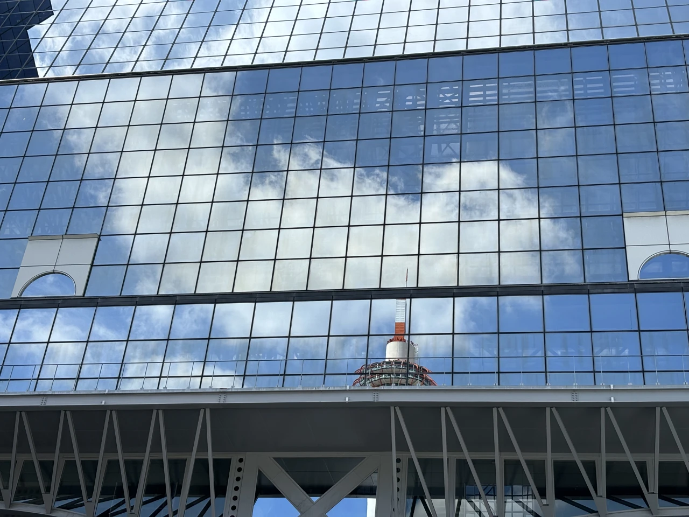
{width="75%"}

## 2024-10 Guangzhou, China

, a famous mega mall in Guangzhou.")
{width="80%"}

## 2025-02 Guangzhou, China

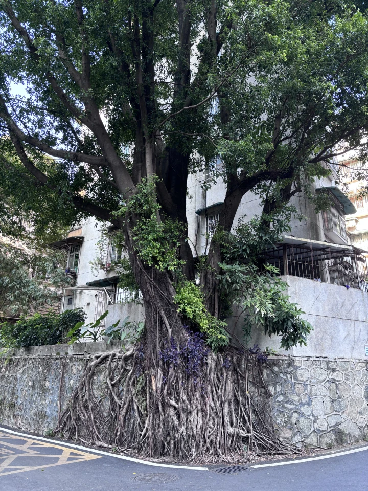
{width="50%"}

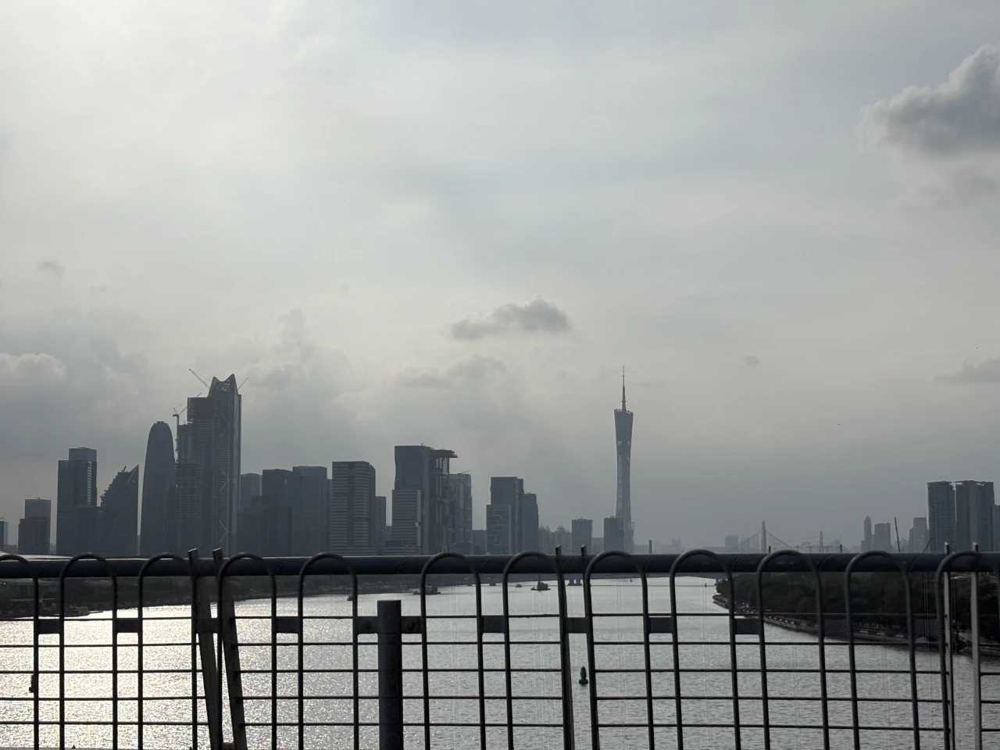
{width="75%"}

## 2025-07 Kyoto, Japan

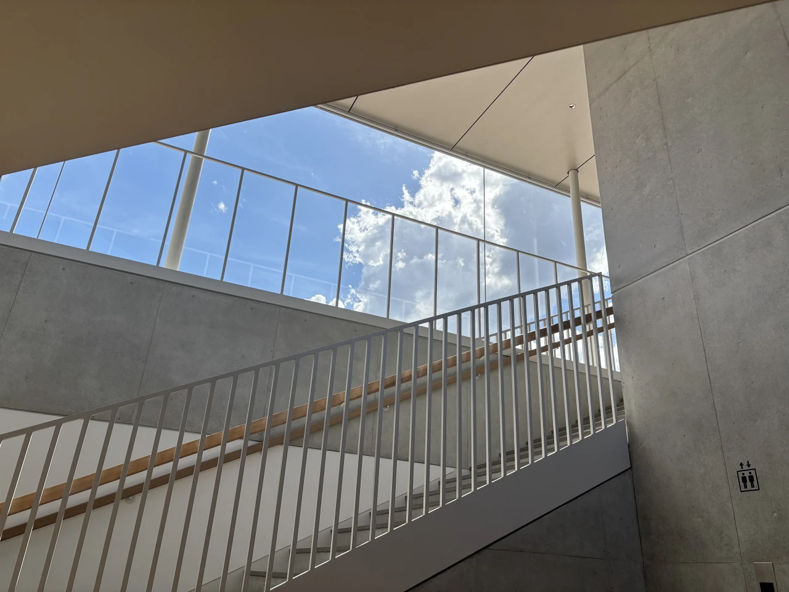
{width="75%"}

## 2025-10 Shanghai, China

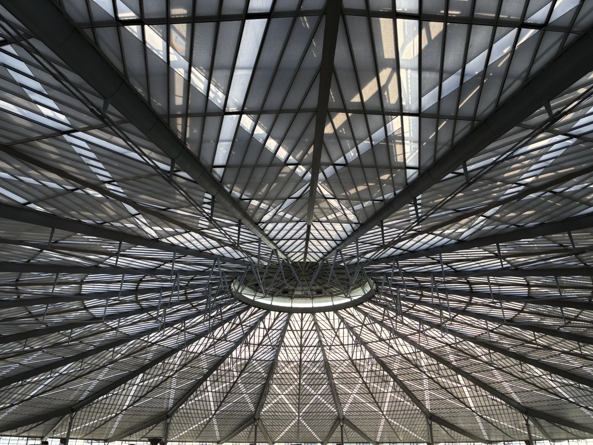
{width="75%"}

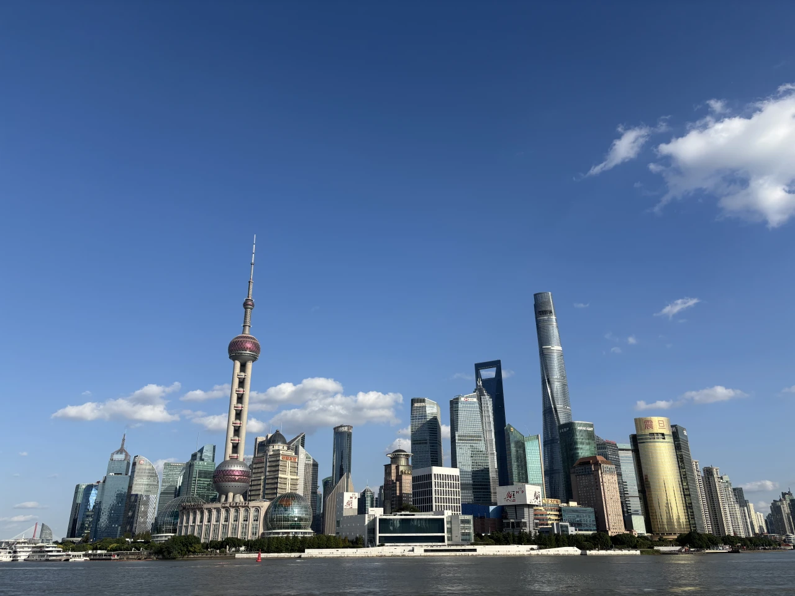
{width="75%"}

## 2026-02 Kyoto, Japan

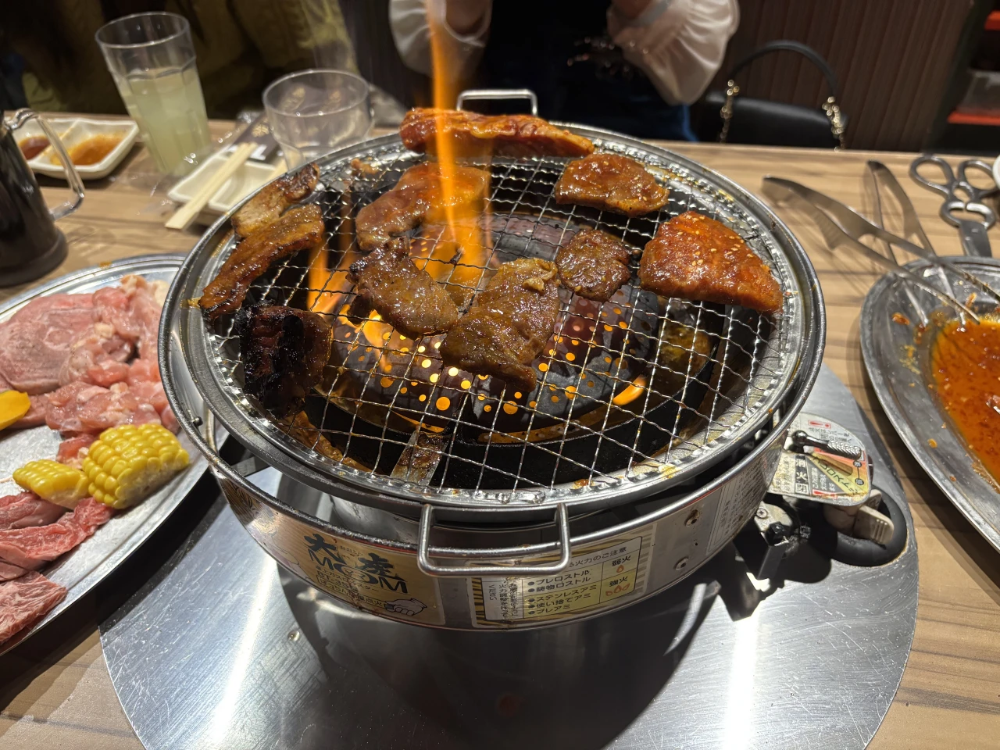
{width="75%"}

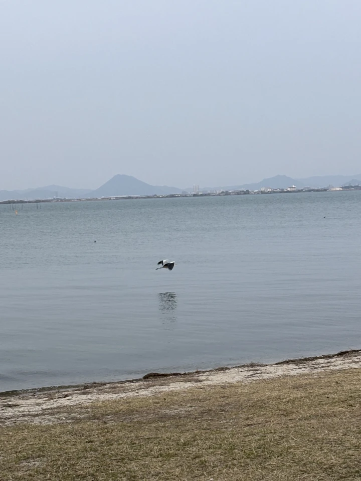
{width="60%"}

## 2026-04 Shanghai, China

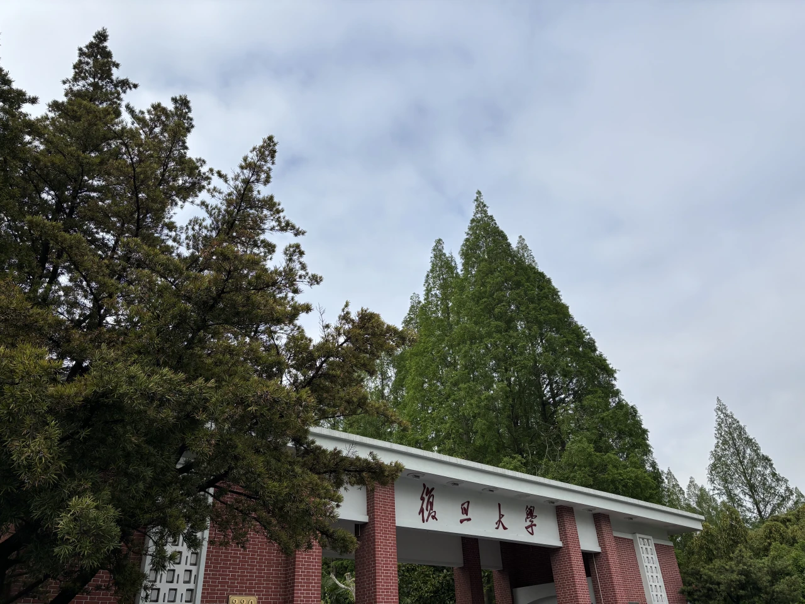
{width="75%"}

## 2026-10 Jiuzhaigou, Sichuan, China

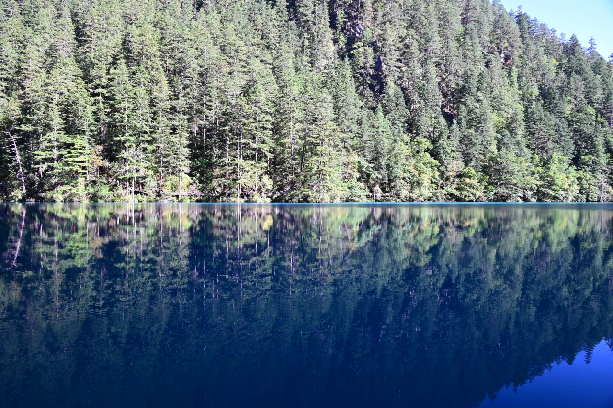
{width="75%"}

## 2026-11 Kada, Wakayama, Japan

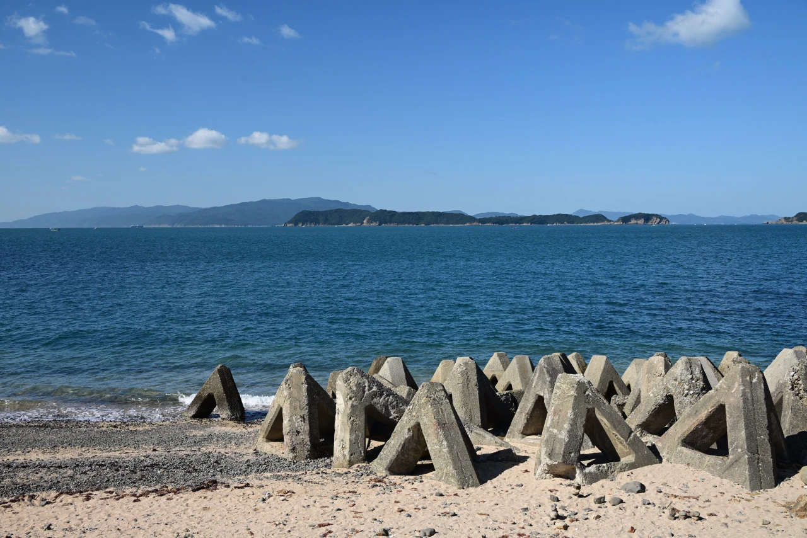
{width="75%"}

I starts to enjoy my life, enjoy the journey, enjoy every hour every day, after all, how hard could it be.
