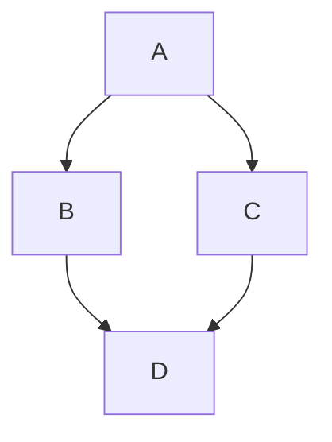

## Attachment

The `attachment` shortcode links to a page, global, or remote resource. Page and global resources show their file size (B, KB, MB, or GB) next to the name:



Use `name` to change the link text, or `icon=false` to hide the icon:



Use `size=false` to hide the size:



Set `params.attachment.showIcon = false` or `params.attachment.showSize = false` to hide icons or sizes site-wide.

Other `type` values:

- `code`: 
- `image`: 
- `tarball`: 

Icons come from `params.attachment.iconmap`; `default` is the fallback for `file`, an unset type, or an unknown type.

Page resources use `location="page"` (default), files under `assets/` use `location="global"`, and URLs use `location="remote"`. Remote files are linked directly instead of being fetched during the build, so they show no size:



## Tabs

### Single Tab

Single tab:

So lonely


### Tab Panels

Tab panel `` with tab1 selected `choice=2` by default:



1



22



333



4444




nested tab panels:










Yeah, you like that?




```C
#include <stdio.h>

int main() {
    printf("WE NEED NEST!!!");
    return 0;
}
```








### Grouping Tabs

You can also group several tab panels by specifying the `group` attribute.
It's used for synchronizing tab choices across tab panels in the same group, e.g. a doc on different platforms.


 Hello 
 o_O 
 O_O 



 World 
 Win 
 Mac 


Tab choices are persistent, try reloading this page.

## Details


This is a detail



This is a detail, open by default



This is a detail, but not collapsible



This is a detail, marker at begin



This is a detail, marker at middle



This is a detail, with custom summary marker


{{< details title="This is a title" open="yes" icon=`<svg iewBox="0 0 24 24" fill="none" xmlns="http://www.w3.org/2000/svg"><g id="SVGRepo_bgCarrier" stroke-width="0"></g><g id="SVGRepo_tracerCarrier" stroke-linecap="round" stroke-linejoin="round"></g><g id="SVGRepo_iconCarrier"> <path d="M16.1111 3C19.6333 3 22 6.3525 22 9.48C22 15.8138 12.1778 21 12 21C11.8222 21 2 15.8138 2 9.48C2 6.3525 4.36667 3 7.88889 3C9.91111 3 11.2333 4.02375 12 4.92375C12.7667 4.02375 14.0889 3 16.1111 3Z" stroke="#000000" stroke-width="2" stroke-linecap="round" stroke-linejoin="round"></path> </g></svg>` >}}
This is a detail, with a heart icon


## Admonitions


This is a note admonition



This is an info admonition



This is a tip admonition



This is a help admonition



This is an alert admonition



You can customize admonition title:

This is a collapsible info, with custom title


You can make it collapsible:

This is a collapsible info, with custom title, collaspsible and closed by default


You can also specify whether it should be opened by default:

This is a collapsible info, with custom title, collaspsible and open by default



Note that you can use the shortcode `` to replace ``, it's less verbose:

This is a note admonition



This is an info admonition



This is a tip admonition



This is a help admonition



This is an alert admonition



You can have nested admonitions:

This is a note admonition

And this is an info admonition, inside a note

And this is a tip admonition, inside an info inside a note




## Sidenotes


Look at me! I'm a side note! Look at this freaking sidenote!

Lorem ipsum dolor sit amet, consectetur adipiscing elit, sed do eiusmod tempor incididunt ut labore et dolore magna aliqua. Ut enim ad minim veniam, quis nostrud exercitation ullamco laboris nisi ut aliquip ex ea commodo consequat. Duis aute irure dolor in reprehenderit in voluptate velit esse cillum dolore eu fugiat nulla pariatur. Excepteur sint occaecat cupidatat non proident, sunt in culpa qui officia deserunt mollit anim id est laborum.

Lorem ipsum dolor sit amet, consectetur adipiscing elit, sed do eiusmod tempor incididunt ut labore et dolore magna aliqua. Ut enim ad minim veniam, quis nostrud exercitation ullamco laboris nisi ut aliquip ex ea commodo consequat.

Another freaking sidenote with pythagorean theorem $a^2 + b^2 = c^2$

Duis aute irure dolor in reprehenderit in voluptate velit esse cillum dolore eu fugiat nulla pariatur. Excepteur sint occaecat cupidatat non proident, sunt in culpa qui officia deserunt mollit anim id est laborum.

## Commands

### Single Command

Display commands and their outputs.

Line layout (default):

ls -al


Block layout:

ls -al


Multi-line commands:

Line layout:

ls -al \
qwd \
qdwwqd


Block layout:

ls -al \
qwd \
qdwwqd


### Command Outputs

Command with outputs:

ls -al ls -al ls -al ls -al ls -al

total 240
drwx------. 34 xack xack  4096 Jun  3 02:43 .
drwxr-xr-x.  4 root root  4096 May  4 02:02 ..
drwxr-xr-x.  9 xack xack  4096 May 29 00:54 Alice




ls -al

total 240
drwx------. 34 xack xack  4096 Jun  3 02:43 .
drwxr-xr-x.  4 root root  4096 May  4 02:02 ..
drwxr-xr-x.  9 xack xack  4096 May 29 00:54 Alice



### Mutiple Commands in a Shell



mkdir hello && cd hello && touch hello.c



cat >> hello.c << EOF
#include <stdio.h>
int main()
{
    printf("hello world\n");
    return 0;
}



cat hello.c

#include <stdio.h>
int main()
{
    printf("hello world\n");
    return 0;
}




gcc hello.c



ls -al

total 32
drwxr-xr-x.  2 root root  4096 Jun  3 11:40 .
drwx------. 35 root root  4096 Jun  3 11:40 ..
-rwxr-xr-x.  1 root root 12568 Jun  3 11:40 a.out
-rw-r--r--.  1 root root    78 Jun  3 11:40 hello.c




./a.out

hello world






## $\LaTeX$ Support

Three independent features, each off until you enable it. Set them site-wide in `params.tex`, or per page in front matter:

```yaml
tex:
  math: true       # formulas
  algorithm: true  # algorithm blocks
  tikz: true       # tikz diagrams
```

Page front matter wins over the site value, so a site-wide `math: true` can still be turned off on a single page.

Math and algorithms share one engine, chosen with `params.tex.engine`:

| `engine` | Renders | Good for |
|---|---|---|
| `mathjax` (default) | in the browser | the widest LaTeX coverage |
| `katex` | in the browser | faster startup |
| `hugo` | at build time | pages that should ship no math JavaScript |

The `hugo` engine renders with the KaTeX built into Hugo, so the page loads no math script.

### Math

Inline math goes between `$...$`, or `\(...\)` which is equivalent and safer on pages that also contain prices or shell prompts starting with `$`:

```md
Inline math sits in a sentence: $a^2 + b^2 = c^2$.
```

Rendered: inline math sits in a sentence, $a^2 + b^2 = c^2$.

Display math takes two forms. A `$$...$$` block:

```md
$$
A = \begin{pmatrix}
a_{11} & a_{12} \\
a_{21} & a_{22}
\end{pmatrix},
\qquad
f(x) = \begin{cases}
x^2 & x \ge 0, \\
-x  & x < 0.
\end{cases}
$$
```

Which renders as:

$$
A = \begin{pmatrix}
a_{11} & a_{12} \\
a_{21} & a_{22}
\end{pmatrix},
\qquad
f(x) = \begin{cases}
x^2 & x \ge 0, \\
-x  & x < 0.
\end{cases}
$$

Or a fence tagged `math`, which keeps long expressions readable in the source:

````md
```math
\int_{-\infty}^{\infty} e^{-x^2} \, dx = \sqrt{\pi}
```
````

Which renders as:

```math
\int_{-\infty}^{\infty} e^{-x^2} \, dx = \sqrt{\pi}
```

Aligned equations, with summation and fractions:

```md
$$
\begin{aligned}
\nabla \cdot \mathbf{E} &= \frac{\rho}{\varepsilon_0}, \\
\nabla \times \mathbf{B} &= \mu_0 \mathbf{J}
    + \mu_0 \varepsilon_0 \frac{\partial \mathbf{E}}{\partial t}, \\
\sum_{k=1}^{n} k &= \frac{n(n+1)}{2}.
\end{aligned}
$$
```

Which renders as:

$$
\begin{aligned}
\nabla \cdot \mathbf{E} &= \frac{\rho}{\varepsilon_0}, \\
\nabla \times \mathbf{B} &= \mu_0 \mathbf{J}
    + \mu_0 \varepsilon_0 \frac{\partial \mathbf{E}}{\partial t}, \\
\sum_{k=1}^{n} k &= \frac{n(n+1)}{2}.
\end{aligned}
$$

Inline math also mixes with prose: the norm $\lVert x \rVert_2 = \sqrt{\sum_i x_i^2}$, the inner product $\langle u, v \rangle$, and a small fraction $\frac{a}{b}$ all work mid-sentence.

`math` is the only math fence name. `katex` and `mathjax` are not: a fence tagged with either renders as highlighted source instead. Every engine covers `\begin{aligned}`, `\begin{pmatrix}`, and `\begin{cases}`.

With `engine = 'hugo'` the site has to enable the Goldmark passthrough extension, since Hugo does not inherit `[markup]` from a theme, and the delimiters below must match `params.tex.*Delimiter`:

```toml
[params.tex]
    engine = 'hugo'
    math = true

[markup]
    [markup.goldmark.extensions.passthrough]
        enable = true
        [markup.goldmark.extensions.passthrough.delimiters]
            block = [['\[', '\]'], ['$$', '$$']]
            inline = [['\(', '\)']]
```

Because the extension sees every page, a lone `$` in prose such as "costs $5" would otherwise start a formula; write `\$` for the dollar sign. `params.tex.hugo.output` picks the markup: `mathml` (the default, needs no CSS), `html`, or `htmlAndMathml`, and the stylesheet is linked automatically for the last two.

### Algorithms

Wrap `algorithmic` markup in the `algorithm` shortcode. Math inside is typeset for you, so no delimiters are needed there beyond the usual `$...$`.

```

\begin{algorithm}
\caption{Quicksort}
\begin{algorithmic}
\PROCEDURE{Quicksort}{$A, p, r$}
    \IF{$p < r$}
        \STATE $q = $ \CALL{Partition}{$A, p, r$}
        \STATE \CALL{Quicksort}{$A, p, q - 1$}
        \STATE \CALL{Quicksort}{$A, q + 1, r$}
    \ENDIF
\ENDPROCEDURE
\PROCEDURE{Partition}{$A, p, r$}
    \STATE $x = A[r]$
    \STATE $i = p - 1$
    \FOR{$j = p$ \TO $r - 1$}
        \IF{$A[j] < x$}
            \STATE $i = i + 1$
            \STATE exchange
            $A[i]$ with     $A[j]$
        \ENDIF
        \STATE exchange $A[i]$ with $A[r]$
    \ENDFOR
\ENDPROCEDURE
\end{algorithmic}
\end{algorithm}

```

Which renders as:


\begin{algorithm}
\caption{Quicksort}
\begin{algorithmic}
\PROCEDURE{Quicksort}{$A, p, r$}
    \IF{$p < r$}
        \STATE $q = $ \CALL{Partition}{$A, p, r$}
        \STATE \CALL{Quicksort}{$A, p, q - 1$}
        \STATE \CALL{Quicksort}{$A, q + 1, r$}
    \ENDIF
\ENDPROCEDURE
\PROCEDURE{Partition}{$A, p, r$}
    \STATE $x = A[r]$
    \STATE $i = p - 1$
    \FOR{$j = p$ \TO $r - 1$}
        \IF{$A[j] < x$}
            \STATE $i = i + 1$
            \STATE exchange
            $A[i]$ with     $A[j]$
        \ENDIF
        \STATE exchange $A[i]$ with $A[r]$
    \ENDFOR
\ENDPROCEDURE
\end{algorithmic}
\end{algorithm}


The grammar is [pseudocode.js](https://saswat.padhi.me/pseudocode.js)': `\STATE`, `\IF`/`\ENDIF`, `\FOR`/`\ENDFOR`, `\WHILE`/`\ENDWHILE`, `\PROCEDURE`, `\CALL`, `\RETURN`, and `$...$` for math.

Appearance is configured under `params.tex.pseudocode`, and a page can override it:

```yaml
tex:
  pseudocode:
    lineNumber: true
    titlePrefix: "Algo"
```

| Key | Default | Meaning |
|---|---|---|
| `indentSize` | `1.6em` | Indent inside a control block. Must carry an `em` unit. |
| `commentDelimiter` | `//` | Line comment marker. Only whole-line comments work. |
| `lineNumber` | `true` | Show line numbers. |
| `lineNumberPunc` | `''` | Punctuation after a line number. |
| `noEnd` | `true` | Hide `end if`, `end procedure`, and friends. |
| `scopeLines` | `false` | Draw vertical lines for nested block scopes. |
| `titlePrefix` | `Algorithm` | Prefix before the caption number. |
| `captionCount` | unset | Restart the caption counter at this number. |

Omit a key to keep the library default.

### TikZ

Wrap TikZ markup in the `tikz` shortcode. A shaded circle with a labelled radius:

```

\begin{tikzpicture}[scale=1.2]
\draw[thick, fill=blue!12] (0,0) circle (1.5cm);
\draw[->, thick] (0,0) -- (1.5,0) node[midway, below] {$r$};
\fill (0,0) circle (2pt) node[below left] {$O$};
\draw[dashed] (-1.5,0) -- (1.5,0);
\end{tikzpicture}

```

Which renders as:


\begin{tikzpicture}[scale=1.2]
\draw[thick, fill=blue!12] (0,0) circle (1.5cm);
\draw[->, thick] (0,0) -- (1.5,0) node[midway, below] {$r$};
\fill (0,0) circle (2pt) node[below left] {$O$};
\draw[dashed] (-1.5,0) -- (1.5,0);
\end{tikzpicture}


A commutative square, where TikZ beats a picture:

```

\begin{tikzpicture}[scale=1]
\node (A) at (0,1.4) {$A$};
\node (B) at (3,1.4) {$B$};
\node (C) at (0,0) {$C$};
\node (D) at (3,0) {$D$};
\draw[->] (A) -- node[above] {$f$} (B);
\draw[->] (A) -- node[left] {$g$} (C);
\draw[->] (B) -- node[right] {$h$} (D);
\draw[->] (C) -- node[below] {$k$} (D);
\draw[->, dashed] (A) to[bend right=20] node[above left] {$\exists!$} (D);
\end{tikzpicture}

```

Which renders as:


\begin{tikzpicture}[scale=1]
\node (A) at (0,1.4) {$A$};
\node (B) at (3,1.4) {$B$};
\node (C) at (0,0) {$C$};
\node (D) at (3,0) {$D$};
\draw[->] (A) -- node[above] {$f$} (B);
\draw[->] (A) -- node[left] {$g$} (C);
\draw[->] (B) -- node[right] {$h$} (D);
\draw[->] (C) -- node[below] {$k$} (D);
\draw[->, dashed] (A) to[bend right=20] node[above left] {$\exists!$} (D);
\end{tikzpicture}


Only TikZ's base colour set is available (`red`, `blue`, `black`, `gray`, and mixtures like `blue!12`). Names from the extended xcolor sets, such as `AliceBlue`, are not defined unless a site preloads them.

TikZ uses [TikZJax](https://tikzjax.com), which renders in the browser and needs network access. Everything else on this page ships with the theme.

## Diargams

### GoAT

https://gohugo.io/content-management/diagrams/#goat-diagrams-ascii

### Mermaid

https://gohugo.io/content-management/diagrams/#mermaid-diagrams

````md

````


## Marks

If this <mark>word</mark> has yellow background color and black font color on your screen,
that's because  https://html.spec.whatwg.org/multipage/rendering.html#phrasing-content-3 :
```css
mark {
    background: yellow;
    color: black;
}
```

Alice also uses `<mark>` to highlight and mark text,
but you can also specify

Here are  some marked text 

Here are  some marked text with `some code` 

Here are  some marked text with [some link](https://github.com/lixk28/Alice) 

Here are  some marked text with some equation $a^2 + b^2 = c^2$ 

Here are  some marked text with some  Amazing  

Here are  some marked text with some  secret  

You can also customize some attributes of mark:
-  color 
-  background color 
-  font scale 
-  font weight 

## Lorem Ipsum

https://en.wikipedia.org/wiki/Lorem_ipsum

You can use `` to generate placeholder text.



You can also specify the number of parapraghs (n) generated by ``,
by default n equals to 1.


